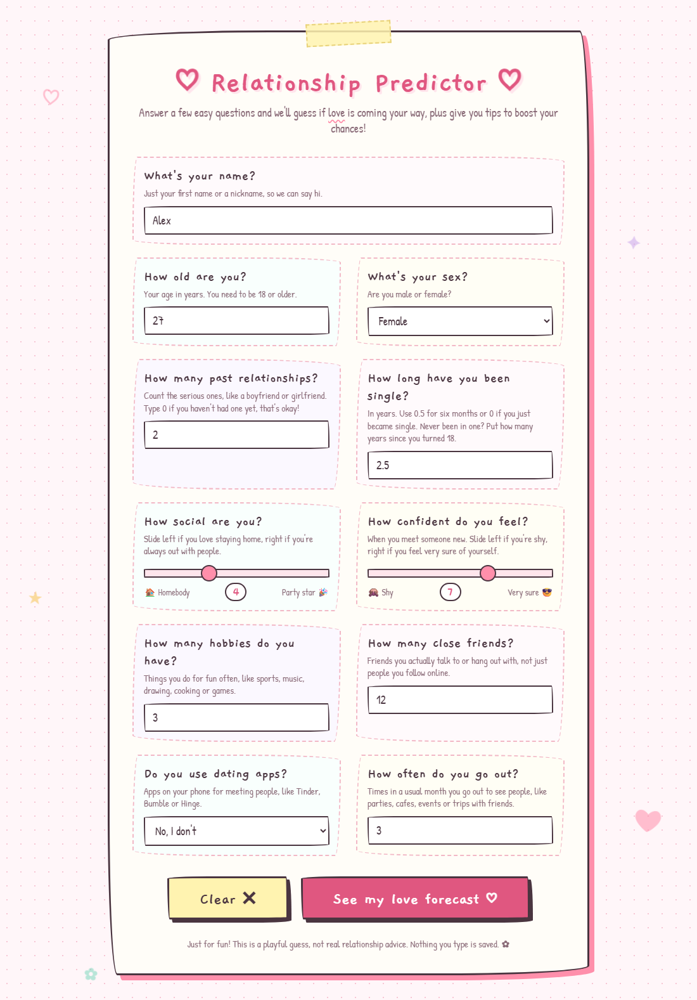
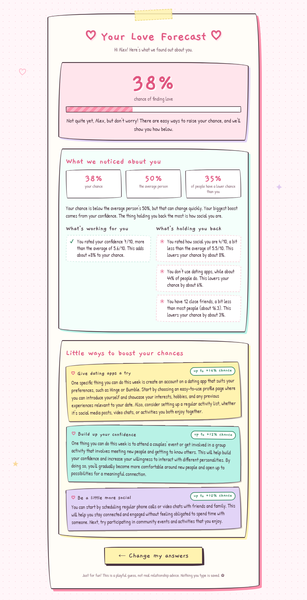

# Relationship Predictor 💕

A playful web app that guesses your chance of finding a relationship, explains what is helping or holding you back, and gives you personal AI-written tips to boost your chances.

> Just for fun! The model is trained on made-up data, so the result is a playful guess, not real relationship advice.

## Features

- **Love forecast:** answer 11 simple questions and a logistic regression model predicts your chance of finding a relationship as a percentage.
- **Insights:** see how you compare with the average person, what share of people have a lower chance than you, and which of your answers raise or lower your chance the most.
- **AI tips:** get three personal, 3-sentence tips written by a small language model, each focused on the change that would help you most.
- **Friendly design:** hand-drawn, doodle-style pages with page transitions, sliders and a description under every question.

## Screenshots

| Answer a few easy questions | Get your forecast, insights and tips |
|---|---|
|  |  |

## How it works

1. **Prediction:** a machine learning model (logistic regression), trained on [dataset.csv](dataset.csv), predicts the chance from your answers. See [Machine learning](#machine-learning) below.
2. **Insights:** the same model explains the result by measuring how much each of your answers raises or lowers your chance.
3. **Recommendations:** the model finds the three changes that would raise your chance the most, and a Hugging Face language model ([Qwen2.5-0.5B-Instruct](https://huggingface.co/Qwen/Qwen2.5-0.5B-Instruct)) writes a tip for each one.

## Machine learning

The prediction is made by a **logistic regression** classifier built with [scikit-learn](https://scikit-learn.org/). The code is in [model/relationship_predictor.py](model/relationship_predictor.py).

### Why logistic regression?

- **Yes-or-no question:** the app predicts one of two outcomes (will or won't have a relationship), which is exactly what logistic regression is built for.
- **Gives a probability:** it returns a chance between 0% and 100%, not just a yes or no, which is what the forecast shows.
- **Easy to explain:** each answer gets one weight, so it's simple to see which answers help and which hurt. That's what powers the insights.
- **Fast and small:** it trains in under a second when the app starts and needs no GPU.

### How it predicts

The model gives each answer a weight, adds them up into a score, and turns the score into a probability with the sigmoid function:

```
score       = b + w1 * age + w2 * sex + ... + w10 * goes_out_per_month
probability = 1 / (1 + e^(-score))
```

If the probability is 50% or more, the prediction is "will have a relationship" (1), otherwise "not yet" (0).

### Pipeline

The model is a scikit-learn pipeline with two steps:

1. **`StandardScaler`** rescales every answer to the same range (mean 0, standard deviation 1). Without it, answers with big numbers like `friends_count` would drown out small ones like `confidence`, and the model would train poorly.
2. **`LogisticRegression(max_iter=1000)`** learns the weights.

The 10 inputs (features) are `age`, `sex`, `past_relationships`, `years_single`, `social_activity`, `confidence`, `hobbies_count`, `friends_count`, `uses_dating_apps` and `goes_out_per_month`. The target (label) is `will_have_relationship`.

### Training and evaluation

The 1,000 rows are split into **800 for training** and **200 for testing** (`train_test_split`, `test_size=0.2`, `random_state=42`). The model never sees the test rows while training, so its scores on them show how well it handles new people.

| Metric | Score | Meaning |
|---|---|---|
| Accuracy | 68.5% | Share of test people predicted correctly |
| Precision | 71.3% | When it says "yes", how often it's right |
| Recall | 65.0% | Of the people who really said "yes", how many it found |
| F1 score | 68.0% | Balance of precision and recall |
| ROC AUC | 0.745 | How well it ranks people by chance (0.5 = guessing, 1.0 = perfect) |

The scores are deliberately not near 100%: the dataset has random noise built in, just like real life, where two people with the same answers can have different outcomes. You can check the accuracy anytime at `GET /api/model/evaluate`.

### What the model learned

These are the learned weights on the scaled answers. A positive weight raises the chance and a negative one lowers it. The bigger the number, the stronger the effect.

| Feature | Weight | Effect |
|---|---|---|
| `confidence` | +0.72 | Strongest boost |
| `social_activity` | +0.61 | Strong boost |
| `uses_dating_apps` | +0.29 | Boost |
| `years_single` | −0.25 | Lowers the chance |
| `goes_out_per_month` | +0.21 | Boost |
| `friends_count` | +0.18 | Small boost |
| `age` | −0.15 | Small drop |
| `hobbies_count` | +0.14 | Small boost |
| `past_relationships` | +0.09 | Very small boost |
| `sex` | −0.05 | Almost no effect |

The model rediscovered the pattern hidden in the synthetic data: confidence and social activity matter most, being single for a long time hurts, and sex has close to no effect.

### How the model powers the insights and tips

- **Comparison with others:** when the app starts, the model scores everyone in the dataset. Your chance is compared with the average, and with the share of people who scored lower than you.
- **Insights (what helps and what hurts):** for each answer, the app swaps your answer for the average answer, asks the model again, and measures the difference. That difference, in percentage points, is how much that answer helps or hurts *you*. Age and sex are left out because they can't be changed.
- **Recommendations (what-if analysis):** the app raises each thing you can change by a realistic step (for example +2 confidence or turning on dating apps), asks the model again, and keeps the three changes with the biggest gain. Those are passed to the language model to write the tips.

### Retraining

The model is trained from `dataset.csv` every time the app starts. To retrain on new data, regenerate or edit the CSV and restart the app. `RelationshipPredictor.append_data()` can also add new labeled rows (with `will_have_relationship` filled in) and save them to the CSV.

## Getting started

### Requirements

- Python 3.10 or newer (built with Python 3.13)
- About 1 GB of free disk space for the AI model, downloaded automatically on first run
- An internet connection on first run (for the model and the Google Fonts)

### Install

```bash
pip install -r requirements.txt
```

### Run

```bash
python main.py
```

Then open http://127.0.0.1:5001 in your browser.

The first start takes a little longer because the AI model is downloaded and loaded. Tips take about a minute to generate on a regular CPU, so the forecast and insights show up first and the tips appear when they are ready.

## Project structure

```
love-predictor/
├── main.py                       # Flask app: pages and API routes
├── requirements.txt              # Python packages to install
├── generate_dataset.py           # Creates the synthetic dataset.csv
├── dataset.csv                   # 1,000 rows of made-up training data
├── docs/screenshots/             # Screenshots used in this README
├── model/
│   ├── relationship_predictor.py # Logistic regression model, insights and what-if improvements
│   └── recommender.py            # AI-written tips using Hugging Face transformers
└── templates/
    ├── _styles.html              # Shared doodle-style CSS, included in both pages
    ├── index.html                # Question form
    └── result.html               # Forecast, insights and tips
```

## API

All endpoints take and return JSON.

| Method | Endpoint | Description |
|---|---|---|
| `POST` | `/api/model/predict` | Returns `prediction` (0 or 1), `probability` and `insights` |
| `POST` | `/api/model/recommend` | Returns up to three AI-written `recommendations`. Responds with `503` if the AI model is not available |
| `GET` | `/api/model/evaluate` | Returns the model's `accuracy` on a held-out test split |

Example request body for `predict` and `recommend`:

```json
{
  "age": 25,
  "sex": 0,
  "past_relationships": 2,
  "years_single": 1.5,
  "social_activity": 5,
  "confidence": 6,
  "hobbies_count": 3,
  "friends_count": 10,
  "uses_dating_apps": 1,
  "goes_out_per_month": 4
}
```

## The dataset

[dataset.csv](dataset.csv) is synthetic. [generate_dataset.py](generate_dataset.py) creates 1,000 people and gives each a hidden chance based on their answers plus random noise. Confidence, social activity and using dating apps raise the chance, while being single for a long time lowers it. Sex has no effect.

| Column | Meaning |
|---|---|
| `age` | 18 to 60 |
| `sex` | 0 = male, 1 = female |
| `past_relationships` | Number of serious past relationships |
| `years_single` | Years since the last relationship |
| `social_activity` | 1 (homebody) to 10 (very social) |
| `confidence` | 1 (shy) to 10 (very confident) |
| `hobbies_count` | Number of regular hobbies |
| `friends_count` | Number of close friends |
| `uses_dating_apps` | 0 = no, 1 = yes |
| `goes_out_per_month` | Times going out to socialize per month |
| `will_have_relationship` | The label: 0 = no, 1 = yes |

To change the number of rows or the hidden formula, edit `generate_dataset.py` and run:

```bash
python generate_dataset.py
```

The current model reaches about 68.5% accuracy on held-out data (see [Training and evaluation](#training-and-evaluation)).

## Customization

- **Better tips:** change `MODEL_NAME` in [model/recommender.py](model/recommender.py) to a bigger model such as `Qwen/Qwen2.5-1.5B-Instruct`. Tips get better but take about three times longer.
- **Tip length:** change `TIP_SENTENCES` and the wording of `SYSTEM_PROMPT` in the same file.
- **Port:** change the port in the last line of [main.py](main.py).
